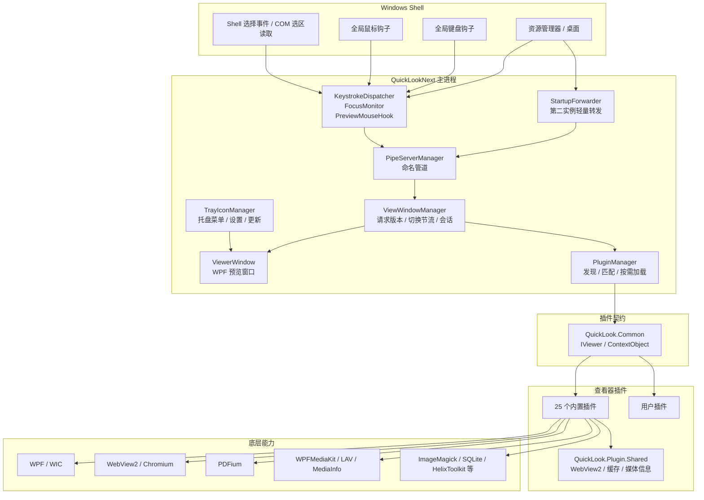
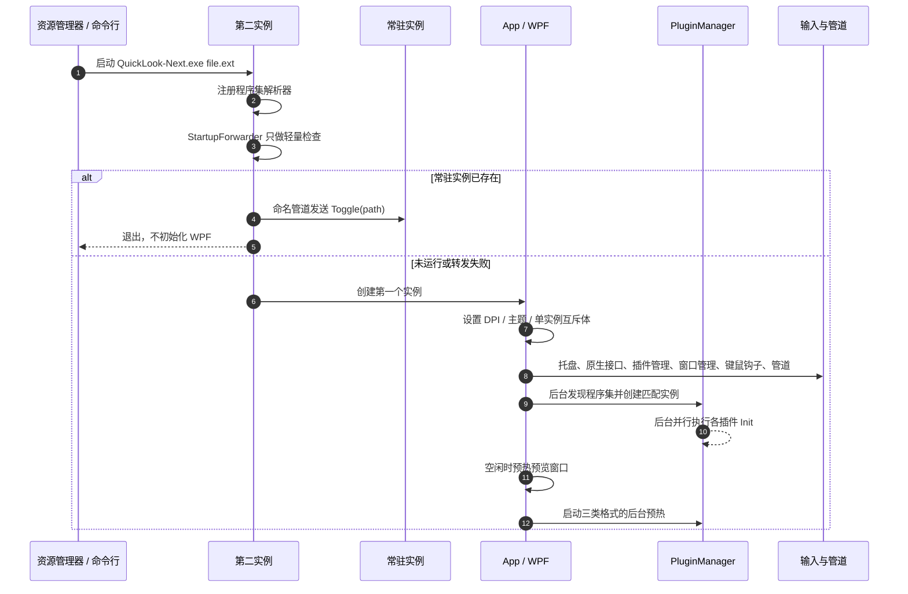
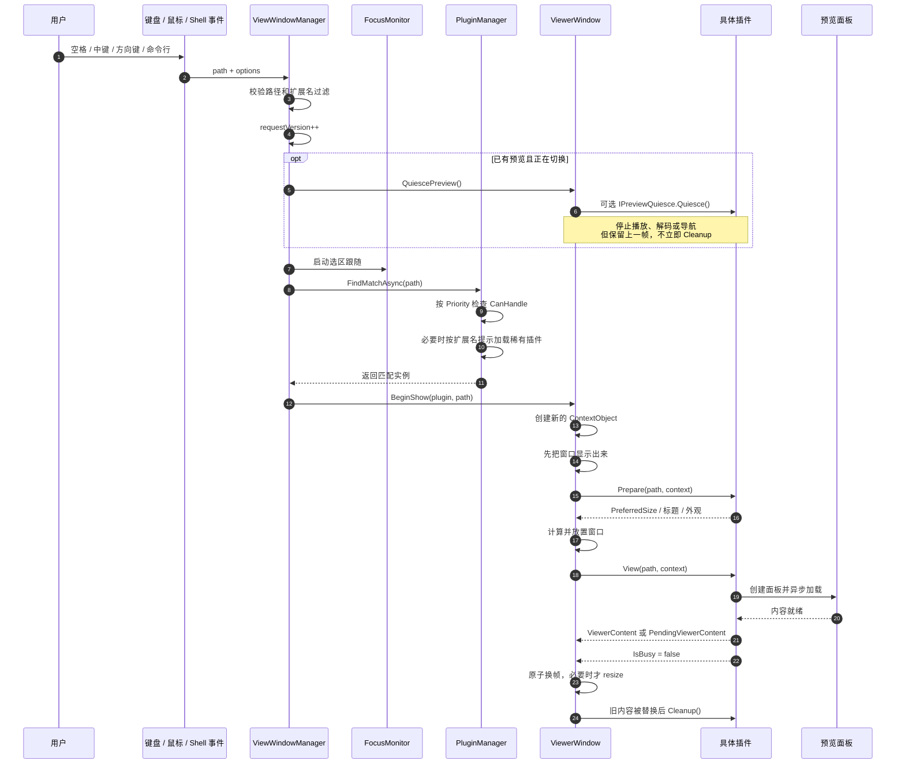

# QuickLook-Next 架构说明

> 适用版本：6.1.1
>
> 文档目的：用一页到几页的篇幅说明项目分层、预览链路、插件生命周期、技术路线和关键设计取舍，便于新同学快速读懂代码。

## 1. 项目定位

QuickLook-Next 是 [QL-Win/QuickLook](https://github.com/QL-Win/QuickLook) 4.5.0 的 .NET 10 衍生版。

它常驻在 Windows 托盘中，监听资源管理器和桌面的文件选择，在用户按下空格、鼠标中键或通过命令行发起请求时，弹出一个预览窗口。项目本身不做文件编辑，核心目标是把“选中文件 -> 找到合适的查看器 -> 尽快显示第一帧”这条链路做得稳定、快速。

项目采用 **单进程、进程内插件** 架构：

- 一个常驻进程负责托盘、输入钩子、窗口、插件和更新。
- 每次预览只创建一个插件实例，避免不同文件之间的状态串扰。
- 图片、视频、PDF、Office、Markdown 等查看器作为独立插件加载。
- 插件共享一套宿主契约和 WebView2/缓存基础设施，但不是独立进程，也没有安全沙箱。

## 2. 全局结构



一句话概括：**Shell 事件进入常驻宿主，宿主按优先级匹配插件，查看器把内容交给统一窗口，窗口在上一帧仍然可见时完成下一帧的替换。**

## 3. 项目分层

当前 `QuickLookNext.slnx` 包含 29 个项目：主程序、公共契约、共享基础设施、25 个查看器插件和 1 个测试工程。

| 项目 | 职责 |
| --- | --- |
| `QuickLookNext` | 主程序。单实例、WPF 窗口、托盘、输入钩子、插件管理、更新、设置、日志和诊断。 |
| `QuickLook.Common` | 插件 SDK 与公共契约。核心是 `IViewer`、`ContextObject`、可选接口和通用帮助类。 |
| `QuickLook.Plugin.Shared` | 插件共享基础设施。程序集名故意设为 `QuickLook.Shared`，避免被 `QuickLook.Plugin.*.dll` 扫描规则当成插件。 |
| `QuickLook.Plugin/*` | 25 个内置查看器。每个插件只负责匹配文件类型、准备窗口参数和生成预览内容。 |
| `QuickLook.Tests` | 无第三方测试框架的控制台测试程序。覆盖宿主逻辑、缓存、窗口尺寸、插件协作等。 |
| `QuickLookNext.Installer` | WiX 安装包工程，不属于主解决方案的日常构建路径。 |
| `QuickLookNext.Appx` | MSIX/AppX 打包工程，不属于主解决方案的日常构建路径。 |
| `Scripts/`、`build.ps1`、`test.ps1` | 构建、运行时依赖检查、冒烟测试和性能测量脚本。 |

代码阅读建议从下面这条主线开始：

```text
Program.Main
  -> App.OnStartup
  -> ViewWindowManager.InvokePreview
  -> PluginManager.FindMatchAsync
  -> ViewerWindow.BeginShow
  -> IViewer.Prepare / View
  -> 具体查看器面板
```

## 4. 启动与单实例

### 4.1 启动流程



关键点：

- 第二实例走 `StartupForwarder`，在 WPF 初始化前完成转发，避免每次预览都支付 XAML/PresentationFramework 的启动成本。
- 主进程使用互斥体和命名管道保证“只驻留一个实例”；开发构建可以通过 `QL_INSTANCE_SUFFIX` 隔离测试实例。
- 插件程序集发现和插件 `Init` 分两个阶段：先让匹配器可用，再在后台并行初始化；预览命中的插件如果尚未初始化，会在使用前单独补齐。
- 托盘、键鼠钩子和管道先启动，插件加载和窗口预热尽量放到后台或空闲时执行。

### 4.2 单实例通信

第二实例只把路径和控制命令写入命名管道。常驻实例在 UI Dispatcher 上处理：

| 消息 | 作用 |
| --- | --- |
| `Toggle` | 打开、关闭或切换预览 |
| `Switch` | 切换当前文件夹中的选择 |
| `Invoke` | 直接打开指定路径 |
| `RunAndClose` | 用默认程序打开并关闭预览 |
| `Close` / `Fullscreen` / `Reload` | 关闭、全屏、重新加载 |
| `Forget` | 固定当前预览并释放窗口归属 |

## 5. 一次预览的完整链路



这条链路里有四个重要的“门”：

1. **请求版本号**：旧请求在匹配或加载完成后，如果已被新请求取代，就不再显示。
2. **显示门**：`ViewerWindow` 只接受当前版本、当前路径和当前插件产生的内容。
3. **切换节流**：资源管理器连续移动选择时，宿主合并密集请求，只处理最后稳定下来的文件。
4. **内容就绪门**：新内容未准备好时，旧画面继续显示；`IsBusy = false` 才是提交新帧的信号。

## 6. 插件契约与生命周期

插件契约位于 `QuickLook.Common/Plugin/IViewer.cs`。

```csharp
public interface IViewer
{
    int Priority { get; }
    void Init();
    bool CanHandle(string path);
    void Prepare(string path, ContextObject context);
    void View(string path, ContextObject context);
    void Cleanup();
}
```

生命周期不是“一个实例服务所有文件”，而是分成匹配实例和渲染实例：

```text
每个插件类型只保留一个长期匹配实例
  Init            只执行一次，可能并行、在后台线程执行
  CanHandle       每次预览都调用，必须便宜且无副作用

每次预览创建一个全新实例
  Prepare         只做快速准备，确定窗口尺寸、标题、主题和工具栏
  View            创建面板并异步加载真正的内容
  IsBusy = false  通知宿主可以提交内容
  Cleanup         释放面板、解码器、定时器和非托管资源

切换到另一个预览时
  Quiesce         可选，立即停止旧预览的播放/解码/导航
  Cleanup         等旧画面真正被新内容替换后再执行
```

### 6.1 为什么 `Init` 和 `Prepare` 不是同一个实例

- `Init` 只用于建立插件类型的静态状态，例如原生库路径、语法高亮表、字体资源索引。
- `Prepare`、`View`、`Cleanup` 使用全新实例，避免上一份文件的字段、事件订阅和取消令牌泄漏到下一份文件。
- 因此，插件不能把 `Prepare` 中创建的窗口控件保存在实例字段里，期待下一次预览还能使用；跨预览复用的对象必须放在静态设施中，并明确所有权。

### 6.2 `ContextObject` 的职责

`ContextObject` 是宿主和插件之间的运行时协议，而不是业务模型。插件通过它向宿主表达：

| 能力 | 用途 |
| --- | --- |
| `PreferredSize` / `SetPreferredSizeFit` | 请求窗口尺寸，并按当前显示器可用区域缩放 |
| `ViewerContent` | 设置当前要显示的面板 |
| `PendingViewerContent` | 先把内容预加载好，等 `IsBusy = false` 时再原子替换 |
| `DeferResizeUntilReady` | 图片等查看器在新帧解码完成前不提前改变窗口比例 |
| `IsBusy` / `ShowBusyIndicator` | 控制加载状态和加载指示器 |
| `Title` / `Theme` / 顶栏属性 | 控制标题、主题和工具栏外观 |
| `HostDesktopSize` | 让插件按窗口即将落上的那块屏幕测量尺寸 |
| `ResizeRequested` / `ApplyPreferredSizeNow` | 内容完成测量后立即请求窗口重排 |

可选的 `IPreviewQuiesce` 用于“切换已经开始，但旧内容还要在屏幕上停留一小段时间”的场景。视频、WebView2、Office 等查看器可以实现它，先暂停播放和后台工作，避免旧预览继续占用 CPU 或网络。

## 7. 插件发现、匹配与按需加载

### 7.1 发现位置

插件扫描顺序是：

1. 用户插件目录：`UserData/QuickLook.Plugin/`
2. 内置插件目录：`<程序目录>/QuickLook.Plugin/`

只扫描 `QuickLook.Plugin.*.dll`。共享库的程序集名是 `QuickLook.Shared`，不会被当成插件。

### 7.2 匹配策略

- 每个插件声明一个 `Priority`，数值越高越优先。
- 宿主按优先级从高到低调用 `CanHandle`。
- `CanHandle` 必须先看扩展名；只有无扩展名或确实无法判断时，才读文件头。
- 同一扩展名的重复预览会复用匹配结果，但每次仍会重新验证缓存位置以上的高优先级插件，避免文件内容变化后选错查看器。
- 同一程序集只会加载一次；用户插件优先于同名的内置插件。

### 7.3 按需加载

不是所有内置插件都在启动时加载。少见格式的插件由 `LazyBuiltinPluginNames` 和 `LazyExtensionHints` 控制：

- 启动时只加载常用查看器。
- 遇到罕见格式时，先根据扩展名提示加载最可能匹配的插件，避免把全部插件都拉进内存。
- 需要读取文件的格式探测放在线程池，避免阻塞 UI 线程。
- 用户从“更多”菜单直接指定插件时，也可以按程序集名加载对应插件。

常见需要延迟加载的插件包括 3D、数据库、PE/ELF、Dump、邮件、字体、Office、Markdown、MediaInfo 等。

## 8. 查看器技术路线

不同格式并不是都走同一条渲染链。项目的主要技术路线如下：

| 预览类别 | 主要插件 | 技术路线 |
| --- | --- | --- |
| 图片 | `ImageViewer` | WPF/WIC 解码常规图片；ImageMagick 处理扩展格式；SVG 使用 Skia/WebView 路径；大图有解码上限和按查看尺寸重新解码。 |
| 视频 / 音频 | `VideoViewer` | WPFMediaKit + LAV Filters 播放；MediaInfo 读取容器、编码、尺寸和旋转信息；文件头嗅探用于扩展名不可靠的文件。 |
| PDF | `PDFViewer` | PDFium 解析文档，后台渲染当前页为位图；左侧缩略图，右侧 WPF `ImagePanel`；首屏按窗口尺寸预留少量 overscan，避免先模糊再变清晰。 |
| Office | `OfficeViewer` | DOCX/PPTX 解析 ZIP/XML、关系和图片；XLSX 使用 MiniExcel 分页；统一生成 HTML，由 WebView2 排版。解析结果进入 `OfficePanelCache`。 |
| Markdown / HTML / CHM / 邮件 | `MarkdownViewer`、`HtmlViewer`、`ChmViewer`、`MailViewer` | 共享 `WebpagePanel` 和 WebView2 环境，支持 mermaid、MathJax、导航门控和页面静默。Markdown 连续切换时会尽量复用同一个面板和 WebView2。 |
| 字体 | `FontViewer` | TrueType/OpenType 常规预览优先使用 FreeType + WPF；需要网页排版或 WOFF 时使用 WebView2。 |
| 文本 / CSV | `TextViewer`、`CsvViewer` | AvalonEdit 负责大文本和语法高亮；CsvHelper 负责 CSV 解析，分页展示。 |
| 压缩包 / 应用包 | `ArchiveViewer`、`AppViewer` | SharpCompress 读取压缩包；选中条目按需临时提取后交给对应预览器。APK、MSI、NuGet、Deb/RPM 等使用各自读取器提取元数据和目录。 |
| 数据库 | `DbViewer` | SQLite/SQLCipher、LiteDB 读取表和记录；MiniExcel 负责导出。 |
| PE / ELF / Dump / 证书 / Prefetch | `PEViewer`、`ELFViewer`、`DumpViewer`、`CertViewer`、`PrefetchViewer` | 原生结构解析和格式化表格，不依赖 Office 或浏览器。 |
| 3D 模型 | `HelixViewer` | HelixToolkit + Assimp，支持常见 3D 格式的网格和材质预览。 |
| 缩略图兜底 | `ThumbnailViewer` | 对没有专用查看器的设计文件格式，调用 Windows Shell 缩略图。 |

## 9. 共享性能基础设施

项目的性能优化主要集中在“避免重复做昂贵的一次性工作”，而不是单纯增加缓存。

### 9.1 WebView2 共享层

`QuickLook.Plugin.Shared` 把原本分散在多个插件里的 WebView2 逻辑集中起来：

- `WebpagePanel`：统一页面宿主、导航完成判断、内容就绪观察、页面静默和失败提示。
- `WebView2ControlPool`：最多保留 2 个空闲控制器，按浏览器参数分组复用，避免每次预览都重新创建 Chromium controller。
- `WebView2EnvironmentCache`：用一个 single-flight 任务共享默认 WebView2 环境，避免并发预览各自创建环境。
- `WebView2Lifecycle`：没有网页预览时启动空闲回收，默认 300 秒后清理控制器和本程序自己的 `msedgewebview2` 进程；配置文件损坏时按“修复锁 -> 原地重建 -> 轮换目录”的顺序恢复。

WebView2 控件和 `CoreWebView2` 都必须在 UI 线程访问。共享层只负责复用和生命周期，不改变这个线程约束。

### 9.2 文件缓存

`BoundedFileCache<T>` 是一个带文件版本校验的 LRU 缓存：

- 键是完整路径。
- 值是解析结果。
- 每次命中都校验文件长度和最后写入时间。
- 同时受条目数、总字节数和单条最大字节数限制。
- 淘汰时执行显式清理回调，避免图片目录或临时文件泄漏。

`OfficePanelCache` 是它的一个具体使用者：

- 最多 8 项。
- 总预算约 96 MB。
- 单个结果最多 48 MB。
- 缓存保存解析后的 HTML 和图片副本；每次面板拿到独立图片目录，避免关闭一个预览时删掉另一个预览的图片。
- 同一文件的并发请求会合并成一次解析。

PDF 的两级位图缓存使用更严格的组合键：

- 整页缓存：完整路径 + 文件长度 + 最后写入时间 + 页码 + 渲染倍率 + 显示器缩放。两个大小和时间戳相同但路径不同的 PDF 不会串页。
- 缩略图缓存：页码 + 显示器缩放 + 像素密度。窗口移到另一块缩放比例不同的显示器后，旧缩略图不会被当成清晰度足够的图像复用。
- 缩略图请求：列表的可见页优先，滚出视口且已被列表回收的排队任务会被取消；仍保留列表容器的页面会继续完成，避免虚拟化控件留下永久空白。单通道渲染避免大量后台任务同时等待 PDFium。滚动停止后才预取前后各一页，省内存模式不预取。
- 渲染互斥：整页渲染期间暂停新的缩略图任务，缩略图不会抢在用户正在看的页面前面占用 PDFium。
- 整页调度：整页渲染由单通道队列执行，只保留最新待渲染页面。已经开始的页面允许完成，但连续切页产生的旧请求会在调用 PDFium 前被丢弃，避免最后一次选择排在整列旧页后面。
- 整页预取：当前页稳定后延迟准备前后各一页，并把它们作为低优先级任务交给同一个队列。用户主动切页会取消尚未开始的预取，因此预取只利用空闲时间，不改变最终停留页面。
- 缩放缓存：同一页在同一显示器缩放下只保留一份最清晰的位图。放大产生的渲染会替换它覆盖的较小倍率，已经更清晰的位图不会因为一次较小倍率的渲染而被丢弃；因此连续缩放不会用同一页的多个倍率占满缓存、挤掉相邻页。
- 预取倍率：缓存命中时按当前视图倍率预取相邻页，不复用更清晰位图的倍率，避免为尚未显示的画面渲染多余像素。
- 缩放渲染上限：整页位图最多 40 MP（与图片查看器一致），最长边不超过 16384 像素。超过上限时按比例缩小像素并同步降低位图 DPI，因此页面显示尺寸不变，只是极高倍率下由较小的源放大；这样 5 倍缩放不会再让 PDFium 和 WPF 同时分配数百 MB 的单张位图。
- 可见区域高清层：整页位图被上限降低清晰度后，查看器只把当前可见区域按屏幕像素密度重新渲染，并覆盖在基础页面上。基础页渲染完成时立即生成；拖动期间在前缘额外多取 40%（其余方向 12%），停止移动约 140 ms 后再补齐。最近两块会留在独立的小缓存里（最多两页、3200 万像素），来回拖动同一区域时直接复用；缓存按页码、倍率、显示器缩放和覆盖范围校验。覆盖层不接收鼠标事件、裁剪在滚动条内侧，不进入整页缓存，省内存模式不生成也不保留。
- 显示状态：`ImagePanel.ZoomFactor` 始终相对于当前位图，查看器另外记住位图自身的渲染倍率。缓存命中更清晰的位图或首屏 overscan 时，按“视图倍率 ÷ 位图倍率”设置显示缩放，因此页面不会因为换了更清晰的源而突然变大。
- 缩放保持：每次整页渲染完成后恢复真实的“适应窗口”状态。放大后改变窗口大小不会把页面拉回适应窗口；翻页会保持当前缩放倍率（在适应窗口时仍按新页面重新适应）。渲染期间用户滚动了页面时，完成回调保留用户的新位置，不会拉回发出请求时的位置。
- 文档生命周期：渲染某个缩略图时不再周期性重建整份 PDF。现代 PDFium 在每次位图渲染结束后关闭页面句柄，缩略图缓存自身又受条目数和字节数限制，因此不需要通过重新复制、解析文件来回收内存。
- 页码来源：左侧列表使用只读的索引视图，`index` 本身就是页码。打开大 PDF 时不再逐页触发集合变更通知，同时仍向 WPF 暴露可按索引访问的 `IList`，保留列表虚拟化。

### 9.3 预览预热

`PreviewWarmUp` 固定准备三类格式，不再提供用户开关：

1. 先读取本机的插件使用统计。
2. 选出最常用的三类可预热格式。
3. 没有足够历史时，用 TextViewer、ImageViewer、MarkdownViewer 等默认顺序补齐。
4. 在应用空闲、没有新预览请求时逐个构建示例面板，并等待异步加载完成。

预热只覆盖能安全、低成本构造样本的格式：文本、Markdown、HTML、CSV、图片、PDF、压缩包、字体。视频、音频和 Office 不参与，因为预热意味着启动播放或构造完整文档。

预热实例使用临时 `ContextObject`，不会挂到真实预览窗口；如果用户刚好预览了同一个格式，预热会跳过该格式，避免抢走正在使用的面板。

### 9.4 省内存模式

`PreviewSession` 控制预览窗口的预热和释放：

- 正常模式：窗口在整个会话期间保持热状态。
- 省内存模式：第一次预览前不预热；用户开始预览后，窗口跟随会话保持热状态。
- 用户停止预览一段时间后，如果屏幕上没有其它应用窗口，宿主通过重启托盘进程真正释放原生模块和 GPU 驱动留下的内存。

### 9.5 媒体信息

- `MediaInfoSession` 在进程内共享一个 MediaInfo 原生入口，避免每个视频插件重复安装解析器。
- `MediaHeaderSniffer` 只读文件开头几 KB，先判断文本、图片、音频、视频或未知容器。
- 对于无法从扩展名判断的文件，先用嗅探拒绝明显不是媒体的文本，再决定是否调用 MediaInfo。

## 10. 并发与一致性设计

预览链路同时涉及 UI 线程、线程池、Shell COM 回调和 WebView2。项目通过这些约束保持一致性：

| 机制 | 解决的问题 |
| --- | --- |
| `requestVersion` | 慢文件加载完成后不能覆盖用户已经切换到的新文件。 |
| `_showGate` | 只允许当前预览的异步内容提交到窗口。 |
| `_quiesceGate` | 切换时旧插件的播放和解码可以停止，但旧画面仍保留。 |
| `SelectionSwitchGate` | 方向键、Shell 选择事件和鼠标侧键产生的重复切换请求会合并，迟到的读取结果会被丢弃。 |
| `IsBusy` + `PendingViewerContent` | 新面板先构建好，再一次性替换旧内容，避免空白和闪烁。 |
| 文件版本戳 | 缓存不会把修改过的旧文件内容当成新内容返回。 |
| 单次解析合并 | 两个预览同时请求同一个 Office 文件时，只解析一次，其余请求等待结果。 |

插件作者需要遵守的规则：

- 不要在 `CanHandle` 中做耗时 IO 或修改全局状态。
- 不要在 `Prepare` 中解析整个文件；窗口尺寸和外观应尽快确定。
- 慢工作放到后台线程，完成后再回到 UI 线程设置内容。
- 不要把当前预览的控件放进静态字段，除非明确实现跨预览复用和互斥。
- 必须在 `Cleanup` 中释放事件订阅、定时器、取消令牌、非托管句柄和临时目录。

## 11. 架构取舍

### 优点

- **预览热路径短**：第二实例轻量转发，常驻进程提前准备插件、窗口和 WebView2。
- **插件生态兼容**：插件契约基本保持上游形状，老插件可以直接加载。
- **切换体验稳定**：旧帧保留到新帧就绪，配合请求版本和显示门，避免闪烁和旧请求覆盖。
- **内存有边界**：懒加载、LRU、空闲回收和按会话释放都有明确策略。
- **格式覆盖广**：25 个内置查看器，常用格式走专用渲染，未知格式有缩略图兜底。

### 代价

- **插件不是独立进程**：插件崩溃、原生库异常或内存泄漏会影响整个宿主，没有进程级隔离。
- **渲染栈混合**：WPF、WebView2、PDFium、Media Foundation/LAV 同时存在，生命周期和 DPI 处理更复杂。
- **缓存和预热换内存**：首屏更快，但常驻内存和一次性初始化成本需要在不同机器上持续测量。
- **按需加载有首次成本**：罕见格式第一次预览会多一次程序集加载和原生库初始化。
- **插件契约仍需要人工纪律**：`Init` 的静态状态、实例生命周期和清理顺序无法完全由编译器保证。

## 12. 构建、测试与运行

### 构建

```powershell
.\build.ps1
```

构建整个 `QuickLookNext.slnx` 的 Release 配置，输出目录为：

```text
Build\Release\
```

入口程序：

```text
Build\Release\QuickLook-Next.exe
```

### 自动测试

`QuickLook.Tests` 是一个不依赖 xUnit/NUnit 的控制台测试程序，退出码 0 表示全部通过：

```powershell
dotnet run -c Release --project QuickLook.Tests\QuickLook.Tests.csproj
```

### 冒烟测试

`test.ps1` 会构建、启动程序并检查图片、文本、Markdown、PDF、视频、Office、压缩包、字体、罕见格式和窗口行为。它属于开发阶段的 GUI 冒烟测试，需要真实桌面环境。

## 13. 推荐阅读顺序

1. `QuickLook.Common/Plugin/IViewer.cs`：先理解插件契约。
2. `QuickLook.Common/Plugin/ContextObject.cs`：理解插件如何向宿主表达尺寸、内容和加载状态。
3. `QuickLookNext/Program.cs` 和 `QuickLookNext/App.xaml.cs`：理解启动和单实例。
4. `QuickLookNext/ViewWindowManager.cs`：理解请求版本、选择切换和会话管理。
5. `QuickLookNext/ViewerWindow.Actions.cs`：理解 `BeginShow` 和内容提交流程。
6. `QuickLookNext/PluginManager.cs`：理解匹配、优先级、懒加载和匹配缓存。
7. `QuickLook.Plugin.Shared/WebpagePanel.cs`：理解 WebView2 页面宿主。
8. 任选一个具体插件，例如 `PDFViewer`、`ImageViewer` 或 `OfficeViewer`，沿着 `Prepare -> View -> Cleanup` 阅读。

## 14. 架构总结

QuickLook-Next 的核心不是“支持了多少格式”，而是把不同格式统一到同一条可预测的预览管线：

```text
Shell 输入
  -> 常驻进程和请求门控
  -> 优先级插件匹配
  -> 一次性 Prepare / View
  -> 内容就绪后原子换帧
  -> 延迟 Cleanup 和缓存/进程回收
```

这条管线把冷启动成本、预览热路径、插件实例生命周期和资源所有权分开处理，因此在保持 QuickLook 插件生态兼容的同时，能够继续针对图片、视频、PDF、Office 和 Web 预览做局部优化。
